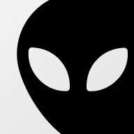
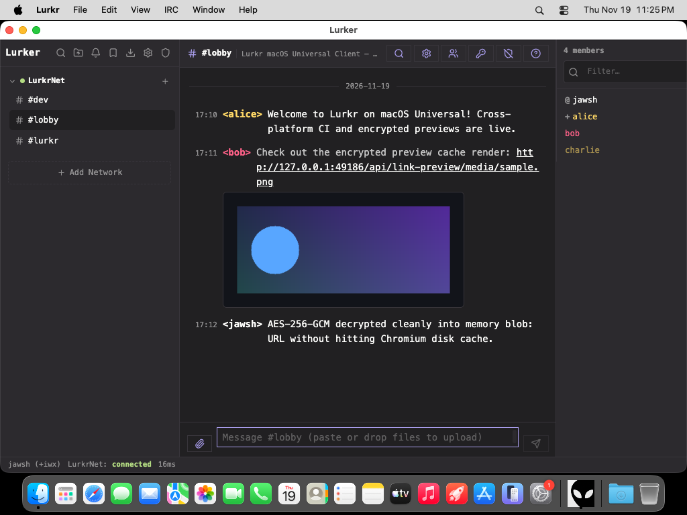
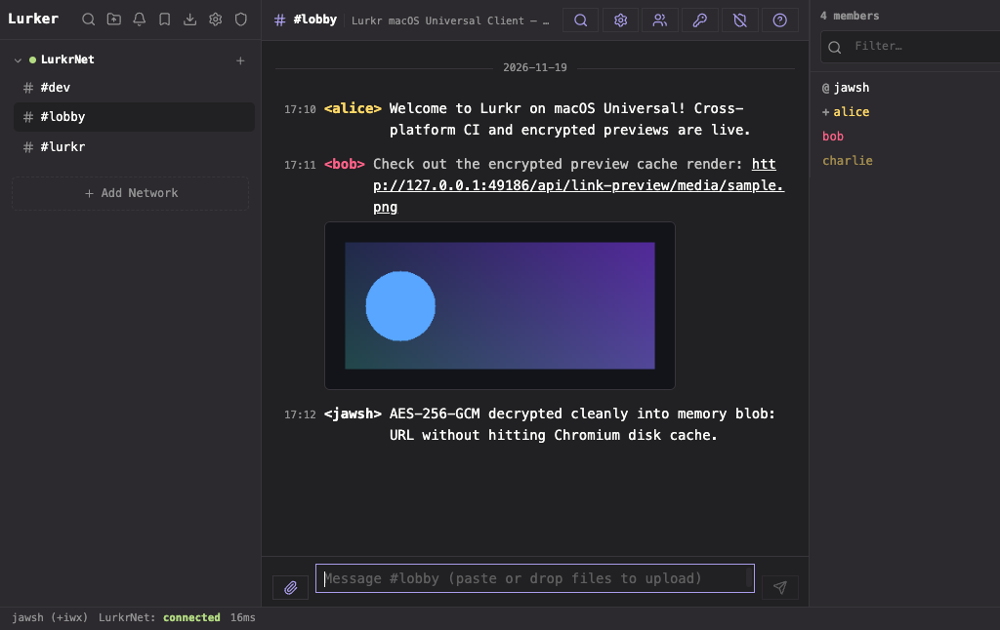
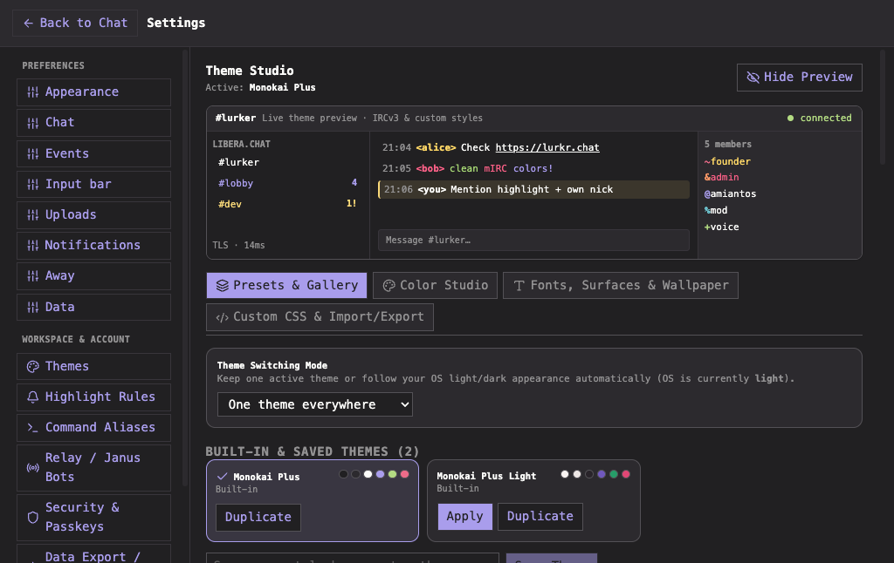
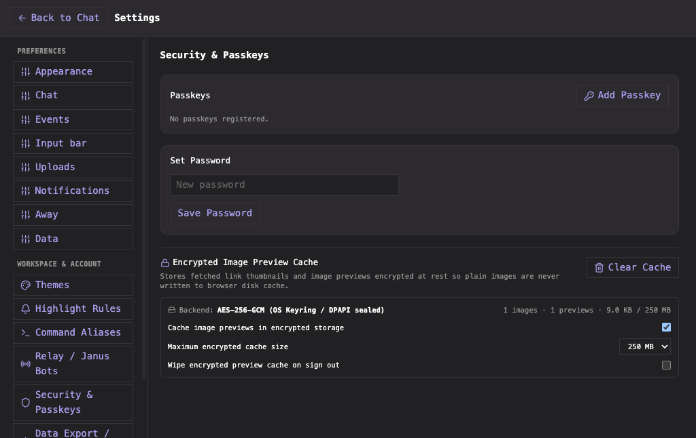
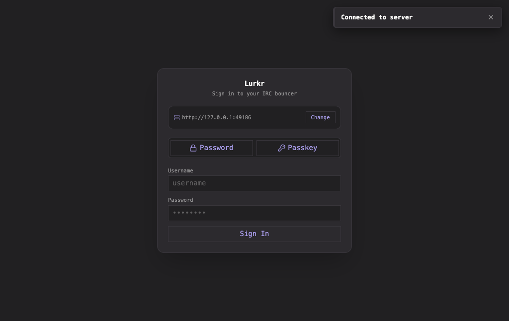
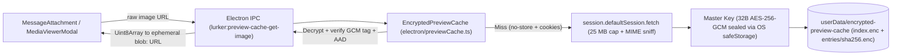

<div align="center">



# Lurkr

**Cross-Platform Electron + React Desktop Client for [Lurker IRC](https://github.com/amiantos/lurker)**

*Encrypted image preview caching · SHA-256 verified auto-updater · Theme Studio with 44 palettes & WCAG checks · Capability-aware IRCd Oper Control Center · Windows, macOS Universal & Linux builds*

[](https://github.com/JawshTheDark/Lurkr/releases)
[](https://github.com/JawshTheDark/Lurkr/actions/workflows/ci.yml)
[](https://opensource.org/licenses/MPL-2.0)
[](#-download--install)
[](#-tech-stack)

[Screenshots](#-screenshots) · [Features](#-features) · [Download & Install](#-download--install) · [Encrypted Preview Cache](#-encrypted-preview-cache) · [Theme Studio](#-theme-studio) · [Development](#-development--building)

</div>

---

## 📸 Screenshots

<p align="center">
  
  <br />
  <sub><b>macOS Universal Desktop App</b> — Native macOS menu bar, `#lobby` buffer with nick-aligned encrypted image previews, live member list, and status bar.</sub>
</p>

<table>
  <tr>
    <td align="center" width="50%">
      
      <br />
      <sub><b>Chat &amp; Nick-Aligned Media Previews</b><br />Timestamps sit in a tabular gutter while wrapped messages &amp; decrypted media cards align cleanly with <code>&lt;nick&gt;</code>.</sub>
    </td>
    <td align="center" width="50%">
      
      <br />
      <sub><b>Theme Studio &amp; Live Preview</b><br />Real-time chat mockup, 44 gallery palettes, WCAG contrast warnings, wallpapers, glass blur &amp; Custom CSS.</sub>
    </td>
  </tr>
  <tr>
    <td align="center" width="50%">
      
      <br />
      <sub><b>Encrypted Image Preview Cache Controls</b><br />Monitor active AES-256-GCM keyring backend, byte usage, quota slider, sign-out wipe, and cache reset.</sub>
    </td>
    <td align="center" width="50%">
      
      <br />
      <sub><b>Server Connection &amp; Auth</b><br />Connect to self-hosted Lurker instances (including self-signed TLS) with Password or WebAuthn Passkeys.</sub>
    </td>
  </tr>
</table>

---

## ✨ Features

### 💬 Modern IRC Bouncer Experience
- **Multi-Network Sidebar & Quick Switcher**: Manage multiple IRC networks (`*status`, channel buffers, queries, unread & highlight badges, live `+typing` indicator dots) with `Ctrl/Cmd + K` quick buffer switching and `Alt + Up/Down` stepping.
- **Rich Message Rendering & Notice Routing**: Nick-aligned wrapped messages, inline media & link previews, click-to-zoom `MediaViewerModal` lightbox, spoiler tags, configurable `chat.notice_buffer` notice placement (`auto` / `private` / `server`) with `:server:` sent-notice redaction, thread drawer (`ThreadPanel`), emoji reactions, replies, bookmarks, message redaction, and message search (`Ctrl/Cmd + F`).
- **Composer, Typing Indicators & mIRC Formatting**: Evenly aligned composer toolbar with mIRC color/style shortcuts (`Ctrl/Cmd + Shift + K` picker, `Ctrl/Cmd + B/I/U`, `Ctrl/Cmd + Shift + S/R/O`), live formatted preview bar, real-time `+typing` (`active`/`paused`/`done`) notifications, and persistent slash-command usage hints highlighting the active argument while typing.
- **Expanded Media Uploads & Video Transcoding**: Native uploads and media playback for images, text/JSON, MP4/MOV/M4V/3GP, **WebM**, **Matroska (`.mkv`/`.mka`)**, **Ogg/Opus/Vorbis (`.ogg`/`.oga`/`.ogv`/`.opus`/`.spx`)**, **FLAC**, **WAV**, and **MP3** (`Ctrl/Cmd + V` paste or drag-and-drop), with automatic desktop FFmpeg fallback for older servers.
- **Channel E2EE, Relay Unwrapping & DCC**: Built-in support for encrypted channel toggles, Relay / Janus bot formatting extraction, DCC chat/file transfers (`/dcc`, `/xdcc`), and interactive Desktop Sheep (`src/lib/sheep/`).

### 🔒 Security, Privacy & Auto-Updates
- **Encrypted At-Rest Image Preview Cache**: Previews and resolved `LinkPreview` metadata are encrypted with **AES-256-GCM** using OS keyring-sealed master keys (`safeStorage`), bypassing Chromium's plaintext HTTP disk cache.
- **Cross-Platform Desktop Auto-Updater**: Checks GitHub Releases on launch or on demand (**Help / App Menu → Check for Updates…**, **About Lurkr**, or **Settings → Desktop Updates**), selects the matching Windows NSIS/Portable, macOS Universal `.zip`/`.dmg`, or Linux AppImage/`.tar.gz` bundle, verifies downloads against `SHA256SUMS.txt`, and supports one-click **Install & Restart**.
- **Passkeys & Password Auth**: Supports WebAuthn passkeys (`@simplewebauthn/browser`), password login/changes, admin first-run setup, account recovery, and OAuth authorization views.
- **Desktop Network Bridge**: Transparently handles Electron `file://` origin cookies (`SameSite`/`Secure` normalization) and optional per-server self-signed TLS certificate acceptance without relaxing global browser security.

### 🎨 Theme Studio
- **2 Built-in Themes + 44 Curated Gallery Palettes**: Ships with Monokai Plus (Dark/Light) plus 44 popular developer & retro themes (Catppuccin Mocha/Frappé/Macchiato/Latte, Dracula, Tokyo Night/Storm/Day, Nord, Gruvbox Dark/Light, Solarized Dark/Light, Rosé Pine/Moon/Dawn, Kanagawa Wave/Dragon, Everforest, Ayu, Night Owl, Vesper, Poimandres, Synthwave '84, OLED Pitch Black, Amber/Phosphor CRT, High Contrast Midnight, and more).
- **WCAG Contrast Guard (`SmartColorControl`)**: Live accessibility contrast indicator while editing window backgrounds, surfaces, borders, text, accents, links, and status tokens.
- **Fonts, Glassmorphism, Wallpapers & Custom CSS**: Font family presets (`Input Mono`, `JetBrains Mono`, `Fira Code`, `Cascadia Code`, `SF Mono / Menlo`, `IBM Plex Mono`, `System Sans`), surface radius, wallpaper tint & backdrop blur sliders, custom CSS snippet library, emergency `?safe=1` safe mode, and import/export for **Lurkr JSON**, **VS Code JSON/JSONC**, and **Base16** schemes.

### 🛡️ IRCd Capability Detection, WHOIS & Oper GUI
- **Automatic IRCd & Services Profiling** (`src/lib/networkCapabilities.ts`): Detects `UnrealIRCd`, `Ergo`, `InspIRCd`, `Solanum`, `Hybrid`, `ngIRCd`, `ircu`, plus `Anope` / `Atheme` / `Ergo` services and dynamically gates UI actions cleanly.
- **Oper Control Center & Toolbar** (`OperConsoleModal.tsx`, `OperToolbar.tsx`): Dedicated GUI and native **IRC** menu integration for `KILL`, `SAJOIN`/`SAPART`, `CHGHOST`, `SWHOIS`, `G-Line`/`Z-Line`/`K-Line`/`D-Line` TKL bans, `Shun`/`Spamfilter`, Ergo `UBAN`/`DEFCON`, server broadcasts, module/DNS inspection, and `REHASH`.
- **Rich WHOIS & Channel Management**: Tabbed `WhoisModal` inspector, channel modes & topic modal (`ChannelModal`), and server-wide `/LIST` channel browser (`ChannelListModal`).
- **150+ Slash & Oper Commands**: Full local & server-side slash command parser, completion, and searchable `IrcCommandsModal` (`F1`).

---

## 📦 Download & Install

Prebuilt cross-platform binaries and `SHA256SUMS.txt` are published automatically on [GitHub Releases](https://github.com/JawshTheDark/Lurkr/releases):

| Platform | Available Artifacts | Quick Install Notes |
| --- | --- | --- |
| **Windows** (`x64` & `arm64`) | `Lurkr-*-win-*-setup.exe`, `Lurkr-*-win-*-portable.exe`, `Lurkr-*-win-*.zip` | Run the NSIS installer, launch Portable `.exe` directly, or extract the `.zip` and run `scripts/install-windows.ps1` / `install-windows.bat` for Start Menu & Desktop shortcuts. |
| **macOS** (`Universal`) | `Lurkr-*-mac-universal.dmg`, `Lurkr-*-mac-universal.zip` | Native Universal binary supporting both Apple Silicon (`arm64`) and Intel (`x64`). Drag `Lurkr.app` into `Applications`. |
| **Linux** (`x64`) | `Lurkr-*.AppImage`, `lurker-react-client-*.tar.gz` | Make `.AppImage` executable (`chmod +x`) and run, or run `npm run install:linux` from source to install into `~/.local/opt/lurkr` + desktop menu. |

### Local Desktop Install Scripts

**Linux (user-local XDG install with Wayland & Ubuntu AppArmor `--no-sandbox` auto-handling):**
```bash
npm run install:linux
```
Installs bundle to `~/.local/opt/lurkr`, CLI wrapper to `~/.local/bin/lurkr`, icons to `~/.local/share/icons/hicolor`, and launcher to `~/.local/share/applications/lurkr.desktop`.

**Windows (PowerShell user-local install):**
```powershell
npm run install:win
# Or from an extracted zip containing scripts/install-windows.ps1:
.\install-windows.ps1
```
Installs into `%LOCALAPPDATA%\Programs\Lurkr` and creates Start Menu & Desktop shortcuts.

---

## 🔐 Encrypted Preview Cache

When displaying remote image previews or thumbnails, Lurkr avoids writing plaintext images to Chromium's unencrypted HTTP cache:



| Detail | Implementation |
| --- | --- |
| **Cipher & Framing** | AES-256-GCM (`LPC1` binary header, random 12-byte IV, 16-byte authentication tag, SHA-256 URL digest AAD) |
| **Key Storage (Desktop)** | 32-byte master key sealed in `master.key.enc` via Electron `safeStorage` (Windows DPAPI, macOS Keychain, Linux Secret Service), or ephemeral in-memory key wiped on `will-quit` (`dispose()`) |
| **Web Fallback** | Non-extractable Web Crypto `AES-GCM` `CryptoKey` + IndexedDB (`lurkr-encrypted-preview-cache`) when running outside Electron |
| **Disk Privacy** | Plaintext URLs, titles, MIME headers, and image bytes never touch disk; filenames are pure SHA-256 hex digests |
| **Cache Controls** | Configure enable/disable, LRU quota (`50 MB`–`1 GB`, default `250 MB`), manual **Clear Cache**, and **Wipe on sign out** in **Settings → Security & Passkeys** |

---

## ⌨️ Keyboard Shortcuts

| Shortcut | Action |
| --- | --- |
| `Ctrl / Cmd + K` | Open Quick Buffer Switcher |
| `Ctrl / Cmd + F` | Search messages |
| `Ctrl / Cmd + J` | Join IRC channel |
| `Ctrl / Cmd + L` | Browse channel directory (`/LIST`) |
| `Ctrl / Cmd + Shift + N` | Add IRC network |
| `Ctrl / Cmd + ,` | Open Settings & Preferences |
| `Alt + Up / Down` | Switch to previous / next buffer |
| `F1` | Open IRC Commands Reference |
| `Ctrl / Cmd + V` | Paste clipboard image/file directly into upload |
| `Tab` | Autocomplete nick, channel, or slash command |
| `Up / Down` | Recall previous sent messages |
| `Shift + Enter` | Insert newline in message composer |
| `Escape` | Cancel reply or close active modal |

Native macOS / Windows / Linux application menus (`File`, `Edit`, `View`, `IRC`, `Theme`, `Oper`, `Window`, `Help`) mirror these actions cleanly (`electron/menu.ts`).

---

## 🛠️ Development & Building

### Prerequisites
- **Node.js** `22+` and `npm`
- **FFmpeg & ffprobe** *(optional, required at runtime for `.webm` → `.mp4`/`.m4a` desktop transcoding and for the FFmpeg integration test in `src/test/transcodeWebm.test.ts`)*

### Setup & Commands

```bash
# Install dependencies
npm ci

# Run Vite + Electron hot-reload development environment
npm run dev

# Typecheck renderer (tsconfig.json) & Electron main/preload (tsconfig.electron.json)
npm run typecheck

# Run full Vitest suite (20 test files, 85 unit & component tests)
npm test

# Production build (renderer + dist-electron)
npm run build
```

### Packaging Targets

```bash
npm run package:linux            # Unpacked Linux x64 directory bundle
npm run package:linux:release    # Linux x64 AppImage & tar.gz
npm run package:win              # Windows x64 & arm64 portable zips
npm run package:win:installer    # Windows x64 & arm64 NSIS setup & portable EXEs
npm run package:mac              # macOS Universal (x64 + arm64) DMG & zip
```

### Project Structure

```text
Lurkr/
├── .github/workflows/
│   ├── ci.yml                     # Cross-platform typecheck, test & package CI
│   ├── release.yml                # Multi-OS release build + SHA256SUMS.txt publisher
│   └── macos-screenshots.yml      # Automated macOS App screenshot capture workflow
├── docs/screenshots/              # Verified macOS screenshots used in README
├── electron/
│   ├── main.ts                    # Window management, IPC handlers, network bridge, TLS
│   ├── menu.ts                    # Native cross-platform app & dynamic Oper menus
│   ├── preload.ts                 # Context-isolated window.lurkerDesktop API
│   ├── previewCache.ts            # EncryptedPreviewCache (AES-256-GCM + safeStorage)
│   ├── transcode.ts               # WebM -> H.264/AAC FFmpeg converter
│   └── updater.ts                 # GitHub Releases updater with SHA256SUMS verification
├── public/                        # App icons, audio cues, avatar sets & sheep sprites
├── scripts/
│   ├── install-linux.sh           # User-local Linux desktop & XDG installer
│   ├── install-windows.ps1 / .bat # Windows user-local installer + shortcuts
│   └── macos-screenshots.mjs      # Mock IRC server + CDP headless/Aqua capture harness
└── src/
    ├── components/                # MessageList, ThemeStudio, OperConsole, WhoisModal, etc.
    ├── hooks/                     # Link previews, media viewer, menus, mobile layout
    ├── lib/                       # Encrypted preview cache Web Crypto fallback, slash commands,
    │                              # IRCd capability detection, 44-palette Theme Gallery
    ├── services/                  # WebSocket client, socketBus, notifications
    ├── shared/                    # Settings registry, IRC mode parsers, relay/e2ee helpers
    ├── stores/                    # Zustand stores (auth, buffers, networks, themes, oper...)
    ├── test/                      # 20 Vitest test suites (85 tests)
    └── views/                     # ChatView, SettingsView, LoginView, AdminView, etc.
```

---

## ⚙️ Automated CI & Releases

| Workflow | Trigger | Coverage |
| --- | --- | --- |
| [`ci.yml`](.github/workflows/ci.yml) | Push / PR to `main` | Installs FFmpeg, runs `typecheck`, `npm test`, and desktop packaging on `ubuntu-latest`, `windows-latest`, and `macos-latest`. |
| [`release.yml`](.github/workflows/release.yml) | Tag push (`v*`) / manual | Verifies all 3 OSes, builds Windows (`x64`/`arm64` setup, portable, zip), macOS (`universal` DMG/zip), Linux (`AppImage`, `tar.gz`), generates `SHA256SUMS.txt`, and publishes GitHub Release artifacts. |
| [`macos-screenshots.yml`](.github/workflows/macos-screenshots.yml) | Manual (`workflow_dispatch`) | Builds `Lurkr.app` on `macos-latest`, launches it against a local mock IRC server via `scripts/macos-screenshots.mjs`, captures CDP + native `screencapture` views, and uploads PNG artifacts. |

---

## 📄 Tech Stack & License

- **Core**: Electron 35 • React 19 • TypeScript 5.8 • Vite 6 • Tailwind CSS 4 • Zustand 5 • Lucide Icons • Vitest 3
- **License**: [Mozilla Public License 2.0 (MPL-2.0)](https://opensource.org/licenses/MPL-2.0) — Original Lurker client author: Brad Root.
